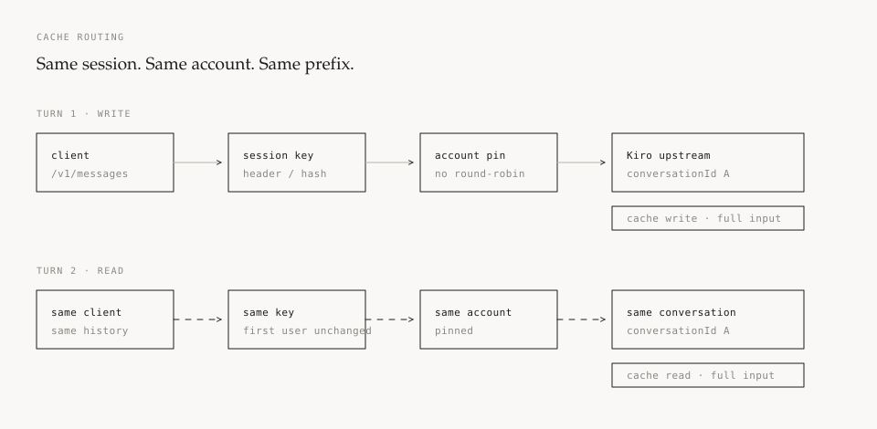
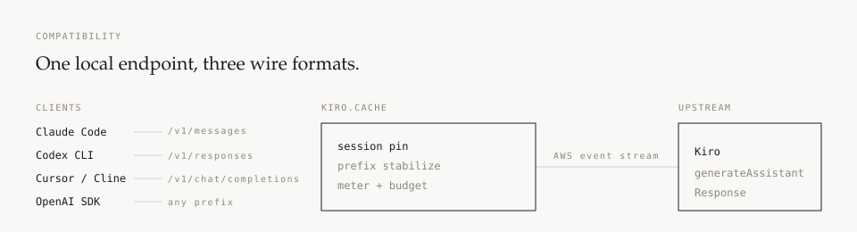

<p align="center">
  
</p>

<h1 align="center">kiro.cache</h1>

<p align="center">
  <strong>把 Kiro 接到 Claude Code、Codex、Cursor，以及任何说 Anthropic / OpenAI 协议的工具。</strong><br />
  会话粘在同一账号和 conversationId 上，让 Kiro 自己的 prompt cache 真正命中。
</p>

<p align="center">
  <a href="https://github.com/wnddd839/kiro.cache/actions/workflows/ci.yml"></a>
  <a href="LICENSE"></a>
  <a href="https://github.com/wnddd839/kiro.cache/releases/latest"></a>
  
  
  
</p>

<p align="center">
  <a href="#30-秒跑起来">快速开始</a> ·
  <a href="#为什么是-cache">为什么是 cache</a> ·
  <a href="#它能做什么">功能</a> ·
  <a href="#客户端接入">客户端</a> ·
  <a href="#文档">文档</a> ·
  <a href="#报告问题">报告问题</a>
</p>

---

## 30 秒跑起来

```sh
git clone https://github.com/wnddd839/kiro.cache.git
cd kiro.cache

cat > .env <<EOF
KIRO_API_KEY=$(openssl rand -hex 24)
KIRO_ADMIN_TOKEN=$(openssl rand -hex 24)
EOF

docker compose up -d --build
```

打开 `http://127.0.0.1:8787/ui`。容器首次打开会要求输入 `KIRO_ADMIN_TOKEN`，之后保存在当前浏览器。在「号池」里登录 Kiro，在「接入」页复制 Base URL 和 API Key，然后：

```sh
# Claude Code
export ANTHROPIC_BASE_URL=http://127.0.0.1:8787
export ANTHROPIC_AUTH_TOKEN=<你的 API Key>
claude
```

```sh
# OpenAI SDK / Codex / Cursor
export OPENAI_BASE_URL=http://127.0.0.1:8787/v1
export OPENAI_API_KEY=<你的 API Key>
```

> 容器里登录 Kiro 时，OAuth 回调到不了容器。管理台会给你一条回调地址：在宿主机浏览器完成登录后，把地址栏里以 `oauth/callback` 结尾的整条 URL 粘回「粘贴回调地址」。
>
> 不想用 Docker？下载单文件二进制即可，见 [部署文档](docs/deployment.md)。

## 为什么是 cache

大多数 Kiro 反代能转发请求，但 cache 命中率很低。原因通常不是模型，而是请求形状：

- 每条请求新建 `conversationId`
- 工具声明顺序随 MCP 加载变化
- system 里带着每次都变的 billing header
- 多账号 round-robin，把同一段对话打散到不同账号

Kiro 的 cache 属于**账号**，也依赖**前缀字节稳定**。换号、换 conversationId、改动前缀，都会让它重新计费。

<p align="center">
  
</p>

这个项目不做本地答案缓存。它做四件事，让上游 cache 有机会命中：

1. **认回同一段会话**：`X-Session-Id`、`prompt_cache_key`，或 `system + 首条 user` 的稳定哈希。
2. **钉住同一个号**：会话优先回到原账号；账号忙时排队，不借号。
3. **钉住 conversationId**：按 会话 + 账号 固定；历史被改写时才轮换。
4. **稳住前缀**：剥离 `x-anthropic-billing-header`、工具按名排序、JSON 对象键规范化、原生 thinking 参数按线程锁定。

<p align="center">
  
</p>

命中率不是一个承诺。它取决于客户端、账号、模型、TTL 和上游行为。管理台把每次请求的 `cache_read` / `cache_write` / `input` 和命中率逐条列出来，你可以用 `conversation_mode: "random"` 做 A/B 对照。详见 [缓存路由](docs/cache.md)。

## 它能做什么

### 协议

- Anthropic Messages：`/v1/messages`，流式 / 非流式、工具调用、thinking
- OpenAI Chat Completions：`/v1/chat/completions`
- OpenAI Responses：`/v1/responses`
- 路径前缀容错：`/v1/v1/messages`、`/anthropic/v1/messages`、尾斜杠都能用

### 账号

- 浏览器 OAuth：Google / GitHub / Builder ID / IAM Identity Center
- 导入 Kiro IDE 凭证
- 手填 access token 或 `ksk_` API key
- 单飞 refresh、冷却、额度、熔断
- 服务器上粘贴回调地址完成登录

### 用量与预算

- 每次请求拆成 input / cache read / cache write / output
- 对下游收费与上游 credits 成本分开记账
- 按 key 的日 / 周 / 月 / 累计预算
- 请求数、credits、美元三种上限
- 模型白名单、RPM、过期时间
- CSV 导出与逐号对账

### 运行

- 单文件二进制，零运行时依赖
- 多架构容器镜像：`linux/amd64`、`linux/arm64`
- 六个页面的本地管理台
- 日志脱敏、key 只存 SHA-256
- 默认 loopback 监听；非本机监听必须有 key
- `probe` 子命令实测上游缓存与计费行为

## 客户端接入

| 客户端 | Base URL | 协议 |
|---|---|---|
| Claude Code | `http://127.0.0.1:8787` | Anthropic Messages |
| OpenAI SDK | `http://127.0.0.1:8787/v1` | Chat Completions |
| Codex CLI | `http://127.0.0.1:8787/v1` | Responses |
| Cursor / Cline / Roo | `http://127.0.0.1:8787/v1` | Chat Completions |

认证头二选一：

```http
x-api-key: sk-kiro-...
Authorization: Bearer sk-kiro-...
```

管理台「接入」页会直接生成可复制的环境变量和 curl 示例。

容器部署的首次登录：打开 `http://127.0.0.1:8787/ui`，输入 `KIRO_ADMIN_TOKEN`；OAuth 完成后把回调地址粘回「号池」页。详见 [部署文档](docs/deployment.md#sign-in-inside-a-container)。

### 已知限制

- `temperature` 不转发，首次出现记一条警告
- `tool_choice` 不转发，`top_p` 不支持
- OpenAI 内置工具（`web_search` 等）不能转发，默认丢弃；可配置为返回 400
- Responses 的 `previous_response_id` 不支持，请每轮发送完整 input
- 公司自建 IdP（`external_idp`）登录暂不支持
- kiro-cli 的 SQLite 登录导入暂不支持，请用浏览器登录或导入 IDE 凭证

## 安装方式

### Docker

当前可直接从源码构建（推荐）：

```sh
docker compose up -d --build
```

或手动构建：

```sh
docker build --build-arg VERSION=dev -t kiro-cache:dev .
```

镜像发布到 GHCR 的 CI 已配置好。**打下一个 `v*` tag 之后**可用：

```sh
docker pull ghcr.io/wnddd839/kiro-cache:latest
```

### 预编译二进制

| 平台 | 文件 |
|---|---|
| Windows x64 / arm64 | `kiro-proxy-windows-amd64.exe` / `kiro-proxy-windows-arm64.exe` |
| Linux x64 / arm64 | `kiro-proxy-linux-amd64` / `kiro-proxy-linux-arm64` |
| macOS Intel / Apple Silicon | `kiro-proxy-darwin-amd64` / `kiro-proxy-darwin-arm64` |

从 [Releases](https://github.com/wnddd839/kiro.cache/releases/latest) 下载，并用 `SHA256SUMS.txt` 校验。

### 从源码

```sh
go build -trimpath -ldflags "-s -w -X main.version=dev" -o bin/kiro-proxy ./cmd/kiro-proxy
```

需要 Go 1.26.4 或更高版本。

## 文档

| 文档 | 内容 |
|---|---|
| [快速开始](docs/getting-started.md) | Docker、二进制、首次登录、客户端配置 |
| [部署](docs/deployment.md) | Docker Compose、systemd、反向代理、出站代理、备份 |
| [配置](docs/configuration.md) | 全部配置项、默认值、环境变量 |
| [API](docs/api.md) | 三种协议、管理接口、错误格式、usage 字段 |
| [缓存路由](docs/cache.md) | 会话键、粘号、conversationId、前缀稳定化、如何测量 |
| [运维与排障](docs/operations.md) | 账号生命周期、失败分类、常见问题、日志 |
| [技术笔记](docs/notes/) | 前缀稳定性、原生 thinking、缓存策略的实测记录 |

<!--
生产环境截图待补。把脱敏后的 overview.png / billing.png / requests.png
放到 docs/screenshots/，再在这里插入对应的 。
-->

## 开发

```sh
make check     # gofmt + vet + test -race
make build     # bin/kiro-proxy
make release   # 交叉编译到 releases/ + SHA256SUMS.txt
make docker    # 本地构建镜像
```

CI 在 Linux 和 Windows 上跑 `gofmt`、`go vet`、`go build`、`go test -race`。
发布流程在打 `v*` tag 时交叉编译六个平台、推送多架构镜像到 GHCR，并生成
Release 附件。

## 目录

```text
cmd/kiro-proxy       入口、login / import-ide / list / probe / healthcheck
internal/server      HTTP、换号重试、SSE、计量、管理 API 与管理台
internal/pool        号池、单飞 refresh、选号、冷却、额度、熔断
internal/kiro        请求构造、event stream 解码、鉴权、失败分类、浏览器登录
internal/meter       token 估算、本地缓存计量、价格表
internal/sessionpin  会话键、粘号、稳定 conversationId
internal/usage       用量账本（JSONL）
internal/openai      OpenAI Chat / Responses 类型与转换
internal/anthropic   Anthropic Messages 类型
internal/normalize   前缀稳定化
internal/keys        下游 key 库
internal/tokenizer   与上游对齐的分词器
internal/probe       上游行为探测
third_party          协议参考实现，不参与构建
```

## 报告问题

这个项目开源的主要目的之一，是收集真实使用中的 issue。提交问题时请带上：

- 平台与版本（`kiro-proxy -version` 或镜像 tag）
- 客户端与版本（Claude Code、Codex、Cursor、SDK…）
- 使用的协议与 Base URL 形式
- 是否配置了 key
- 管理台请求行里的状态、账号、pinned、cache read / write、错误
- 已脱敏的日志

请不要粘贴账号 token、refresh token 或完整请求正文。
[提交 issue](https://github.com/wnddd839/kiro.cache/issues/new/choose) 时可以选择
Bug、功能请求或缓存命中问题模板。

## 免责声明

本项目仅用于**个人学习、研究与自用**。

- **条款风险**：Kiro / AWS 的服务条款不允许在官方客户端之外使用其订阅。是否允许此类调用由你与 Kiro / AWS 的协议决定。使用本项目可能导致账号受限或暂停，风险由你承担。
- **不提供规避手段**：没有逐账号代理、出口 IP 管理或请求特征伪装。不要把它当防封工具。
- **不得转售**：不得用于代充、售卖额度、倒卖账号或商业转售。
- **按原样提供**：不保证上游协议持续兼容，不提供账号，不代管凭据。

本项目与 Kiro、AWS 官方无关联、无隶属、无背书关系。

## License

[BSD 3-Clause](LICENSE)
